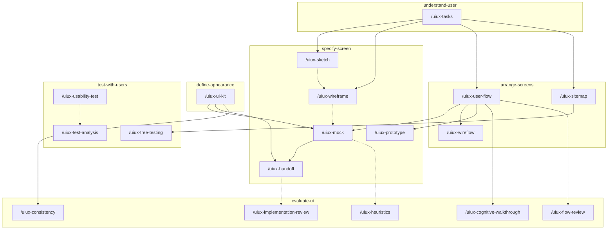

# UI/UX Design (`adrenaline-ui-ux-design`)

Designs the experience and the interface of the screens of a digital product: how they are walked, how they look, and how they are built. It does not write the interface code.

Each piece lives in `skills/<skill>/references/`. The skill of each command is in [Skills](#skills). The result is Markdown and, when the piece is visual, one SVG per screen. Tokens go in `.tokens.json`. Test observations go in CSV.

The instructions are in English. The file the plugin saves follows the language of the request.

## Who it is for

Someone designing screens inside a conversation with the agent. They ask `adrenaline-uml-diagrams` for UML diagrams, `adrenaline-accessibility` for accessibility, and `adrenaline-ux-writing` for copy. This plugin does not copy their skills.

## What it includes

Portable, for any agent that follows [Agent Skills](https://agentskills.io/specification):

- Seven skills. Each one carries the output folder and the fidelity restrictions, for an agent that does not load rules.

Cursor and Claude Code:

- 25 commands: `/uiux-help` (one-line catalog) and one per piece. In Cursor, `/uiux-help` or `/uiux-wireframe`. In Claude Code, `/adrenaline-ui-ux-design:uiux-help`.

Cursor only:

- Rule `output-folder`, which keeps everything in the output folder.
- Rule `ui-fidelity`, which stops a jump in fidelity, a screen without states, or this plugin doing another plugin's job.

## Install

In Cursor, install the plugin from this repository in Customize.

In Claude Code, this repository is also a marketplace:

```text
claude plugin marketplace add d-mente/adrenaline-ui-ux-design
claude plugin install adrenaline-ui-ux-design@adrenaline-ui-ux-design
```

To try a local copy without installing it, start Claude Code with `claude --plugin-dir <path to this repository>`.

In another agent, install the skill with that agent's mechanism. For example:

```text
gh skill install d-mente/adrenaline-ui-ux-design
```

## Configuration

It uses no variables and no services.

Each delivery is saved in `ui-ux-design/` at the project root, with a monotonic `<NNN>` that is not reused. The same delivery shares that number: the Markdown and its SVG, CSV, or `.tokens.json`. The folder keeps `STATUS.md` (`proposed` | `accepted` | `deprecated` | `superseded`). When choosing what to follow, `accepted` wins. The prose of the file follows the language of the request. The type in the file name stays the English piece id. The `STATUS.md` columns stay `N`, `archivo`, `estado`, `sustituye`, `notas`.

To use another folder, add `.cursor/adrenaline.json` to the project:

```json
{
  "outputDirs": {
    "adrenaline-ui-ux-design": "docs/ui"
  }
}
```

The path is relative to the project root and cannot contain `..`. Claude Code and other agents read the same file.

## How to ask

In Cursor, `/uiux-sketch` or the name of another command. In Claude Code, the same name with the plugin prefix: `/adrenaline-ui-ux-design:uiux-sketch`. Asking in plain language is enough: the skill chooses the reference. A request in Spanish produces a Spanish file.

A prerequisite is met by an `accepted` file or by the fact written in the same message. If a stopping one is missing, the command does not write the piece: it says the missing name, gives one prompt, and, if there are earlier commands, gives them in order with one prompt each. Sketch and wireframe can be skipped. A handoff without copy or without notes stays `proposed`. HTML is not delivered.

## Skills

Each command belongs to a skill. The skill is the category: it groups the pieces of the same stretch of the craft. The name is the folder `skills/<skill>/`.

| Skill | What it covers | Commands |
| --- | --- | --- |
| [understand-user](skills/understand-user/SKILL.md) | Tasks, journey map, and brief, before drawing | `/uiux-tasks`, `/uiux-journey-map`, `/uiux-brief` |
| [specify-screen](skills/specify-screen/SKILL.md) | Sketch, wireframe, mock, prototype, and handoff | `/uiux-sketch`, `/uiux-wireframe`, `/uiux-mock`, `/uiux-prototype`, `/uiux-handoff` |
| [arrange-screens](skills/arrange-screens/SKILL.md) | User flow, wireflow, and sitemap | `/uiux-user-flow`, `/uiux-wireflow`, `/uiux-sitemap` |
| [define-appearance](skills/define-appearance/SKILL.md) | Moodboard and UI kit | `/uiux-moodboard`, `/uiux-ui-kit` |
| [evaluate-ui](skills/evaluate-ui/SKILL.md) | Heuristics, cognitive walkthrough, consistency, flow review, and implementation review | `/uiux-heuristics`, `/uiux-cognitive-walkthrough`, `/uiux-consistency`, `/uiux-flow-review`, `/uiux-implementation-review` |
| [test-with-users](skills/test-with-users/SKILL.md) | Usability test, its analysis, card sorting, tree testing, and HEART | `/uiux-usability-test`, `/uiux-test-analysis`, `/uiux-card-sorting`, `/uiux-tree-testing`, `/uiux-heart` |
| [record-decision](skills/record-decision/SKILL.md) | Design decision, and whether that decision governs | `/uiux-decision` |

## Order and prerequisites

A solid arrow stops the destination command if that piece is missing and the message does not bring it. A dotted arrow does not stop: it is an order that can be skipped, or a delivery that stays `proposed`. The prototype also stops if there is no mock, no wireframe, and no screen blocks in the message. Each group is the skill of those commands. Journey map, brief, moodboard, card sorting, HEART, and the decision are not in the diagram: they do not depend on another command.



| Skill | Command | Prerequisites | If missing |
| --- | --- | --- | --- |
| `understand-user` | `/uiux-tasks` | Goal | Stops |
| `understand-user` | `/uiux-journey-map` | Persona, scenario | Stops |
| `understand-user` | `/uiux-brief` | Problem, platform, success criterion | Stops |
| `specify-screen` | `/uiux-sketch` | Task | Stops |
| `specify-screen` | `/uiux-wireframe` | Task | Stops |
| `arrange-screens` | `/uiux-user-flow` | Task, screens | Stops |
| `arrange-screens` | `/uiux-wireflow` | Task, path | Stops |
| `arrange-screens` | `/uiux-sitemap` | Screens and groups, task | Stops |
| `define-appearance` | `/uiux-moodboard` | Visual references | Stops |
| `define-appearance` | `/uiux-ui-kit` | Values: color, type, space, radius, elevation | Stops |
| `specify-screen` | `/uiux-mock` | Task, path, UI kit | Stops |
| `specify-screen` | `/uiux-prototype` | Task, path, drawn screen | Stops |
| `specify-screen` | `/uiux-handoff` | Mock, UI kit, copy, accessibility notes | Mock and UI kit stop. Copy and notes leave `proposed` |
| `evaluate-ui` | `/uiux-heuristics` | Screen or flow | Stops |
| `evaluate-ui` | `/uiux-cognitive-walkthrough` | Task, steps | Stops |
| `evaluate-ui` | `/uiux-consistency` | UI kit, screen | Stops |
| `evaluate-ui` | `/uiux-flow-review` | Path | Stops |
| `evaluate-ui` | `/uiux-implementation-review` | Screenshot or URL, handoff | Without a screenshot or URL it stops. Without an `accepted` handoff it stays `proposed` |
| `test-with-users` | `/uiux-usability-test` | Task, number of participants | Stops |
| `test-with-users` | `/uiux-test-analysis` | Test data | Stays `proposed` |
| `test-with-users` | `/uiux-card-sorting` | Kind: open, closed, or hybrid | Stops |
| `test-with-users` | `/uiux-tree-testing` | Tree | Stops |
| `test-with-users` | `/uiux-heart` | Product launched | Stays `proposed` |
| `record-decision` | `/uiux-decision` | Decision made by whoever asks | Stays `proposed` |

`/uiux-help` has no prerequisites. Copy comes from `adrenaline-ux-writing` or from whoever pastes it. Accessibility notes come from `adrenaline-accessibility`. The journey-map persona comes from whoever asks for the map. Each manual, in `skills/<skill>/references/`, repeats these names and brings the single prompt and the order.

## Catalog

| Skill | Piece | Action | Documentation |
| --- | --- | --- | --- |
| [understand-user](skills/understand-user/SKILL.md) | Tasks | `/uiux-tasks` | [reference](skills/understand-user/references/tasks.md) |
| [understand-user](skills/understand-user/SKILL.md) | Journey map | `/uiux-journey-map` | [reference](skills/understand-user/references/journey-map.md) |
| [understand-user](skills/understand-user/SKILL.md) | Brief | `/uiux-brief` | [reference](skills/understand-user/references/brief.md) |
| [specify-screen](skills/specify-screen/SKILL.md) | Sketch | `/uiux-sketch` | [reference](skills/specify-screen/references/sketch.md) |
| [specify-screen](skills/specify-screen/SKILL.md) | Wireframe | `/uiux-wireframe` | [reference](skills/specify-screen/references/wireframe.md) |
| [specify-screen](skills/specify-screen/SKILL.md) | Mock | `/uiux-mock` | [reference](skills/specify-screen/references/mock.md) |
| [specify-screen](skills/specify-screen/SKILL.md) | Prototype | `/uiux-prototype` | [reference](skills/specify-screen/references/prototype.md) |
| [specify-screen](skills/specify-screen/SKILL.md) | Handoff | `/uiux-handoff` | [reference](skills/specify-screen/references/handoff.md) |
| [arrange-screens](skills/arrange-screens/SKILL.md) | User flow | `/uiux-user-flow` | [reference](skills/arrange-screens/references/user-flow.md) |
| [arrange-screens](skills/arrange-screens/SKILL.md) | Wireflow | `/uiux-wireflow` | [reference](skills/arrange-screens/references/wireflow.md) |
| [arrange-screens](skills/arrange-screens/SKILL.md) | Sitemap | `/uiux-sitemap` | [reference](skills/arrange-screens/references/sitemap.md) |
| [define-appearance](skills/define-appearance/SKILL.md) | Moodboard | `/uiux-moodboard` | [reference](skills/define-appearance/references/moodboard.md) |
| [define-appearance](skills/define-appearance/SKILL.md) | UI kit | `/uiux-ui-kit` | [reference](skills/define-appearance/references/ui-kit.md) |
| [evaluate-ui](skills/evaluate-ui/SKILL.md) | Heuristics | `/uiux-heuristics` | [reference](skills/evaluate-ui/references/heuristics.md) |
| [evaluate-ui](skills/evaluate-ui/SKILL.md) | Cognitive walkthrough | `/uiux-cognitive-walkthrough` | [reference](skills/evaluate-ui/references/cognitive-walkthrough.md) |
| [evaluate-ui](skills/evaluate-ui/SKILL.md) | Consistency | `/uiux-consistency` | [reference](skills/evaluate-ui/references/consistency.md) |
| [evaluate-ui](skills/evaluate-ui/SKILL.md) | Flow review | `/uiux-flow-review` | [reference](skills/evaluate-ui/references/flow-review.md) |
| [evaluate-ui](skills/evaluate-ui/SKILL.md) | Implementation review | `/uiux-implementation-review` | [reference](skills/evaluate-ui/references/implementation-review.md) |
| [test-with-users](skills/test-with-users/SKILL.md) | Usability test | `/uiux-usability-test` | [reference](skills/test-with-users/references/usability-test.md) |
| [test-with-users](skills/test-with-users/SKILL.md) | Test analysis | `/uiux-test-analysis` | [reference](skills/test-with-users/references/test-analysis.md) |
| [test-with-users](skills/test-with-users/SKILL.md) | Card sorting | `/uiux-card-sorting` | [reference](skills/test-with-users/references/card-sorting.md) |
| [test-with-users](skills/test-with-users/SKILL.md) | Tree testing | `/uiux-tree-testing` | [reference](skills/test-with-users/references/tree-testing.md) |
| [test-with-users](skills/test-with-users/SKILL.md) | HEART | `/uiux-heart` | [reference](skills/test-with-users/references/heart.md) |
| [record-decision](skills/record-decision/SKILL.md) | Design decision | `/uiux-decision` | [reference](skills/record-decision/references/decision.md) |

## License

MIT. See [LICENSE](LICENSE).
