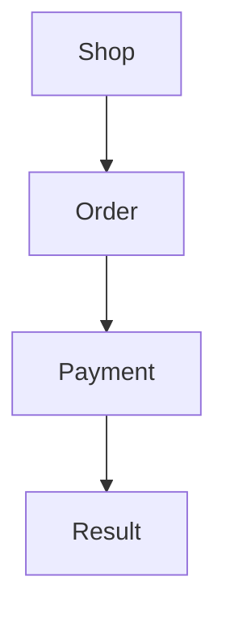

# Sitemap

Source: this plugin's grouping of screens. It is not a UML package diagram. Checking whether people find an item in that hierarchy is tree testing (`test-with-users`), not this map.

## What it fixes

Which screens exist and how they are grouped.

## What it leaves open

The path of one task (user flow) and the appearance of each screen.

## How to do it

1. A group is a place in the product (Account, Order, Payment). A leaf is a screen.
2. Each screen names the task or the use case it covers. If a screen covers none, ask before including it.
3. Mermaid `flowchart` top to bottom, or a nested list if the map is short. No UML notation.
4. Do not rename groups to "improve" the map. The names are the product's or the ones the user just decided. Proposing other names is a decision (`record-decision`) or a card-sorting finding.

## Template

````markdown
# Sitemap — <product>

- Platform:
- Source: this plugin's screen map. It is not UML.



## Screens

| Group | Screen | Task or use case |
| --- | --- | --- |
````

## Example

Shop → Order → Payment → Result. Payment covers the task "pay with a card". Result covers the same task, in the success state.

## Prerequisites

- **Screens and groups.** The list, in this turn. Stops the delivery. No earlier command.
- **Task.** Each screen names the task it covers. An `accepted` task analysis, or the task in this turn. Stops the delivery. Earlier command: `/uiux-tasks`.

## Prompts

In one message:

```text
/uiux-sitemap of the shop.
Groups: Shop → Order → Payment → Result.
Payment and Result cover the task pay with a card.
```

In order, omitting the ones already met:

```text
/uiux-tasks
The goal is to pay an order with a card. Tasks: review the amount, enter the card, confirm.
```
