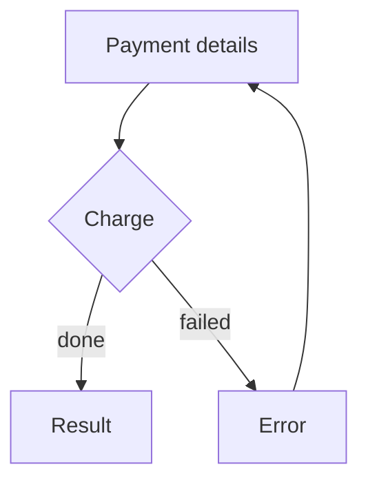

# User flow

Source: Nielsen Norman Group, Task Analysis, for the task the path completes. The drawing is a screen flow in Mermaid, not a UML diagram.

## What it fixes

The path between screens to complete a task, including decisions and returns.

## What it leaves open

The layout of each screen. That is the wireframe or the wireflow.

## How to do it

1. A node is a screen. A decision is a diamond with named exits. The start is the first screen of the task.
2. Every path ends in success, in an error the person can leave, or in an exit the user asked for. If a node has no exit, it is a dead end: mark it and leave the delivery `proposed` until it is resolved.
3. The error of a task that keeps data returns to the screen where that data is.
4. Use `flowchart`. Do not use UML activity, state, or sequence syntax.
5. The Markdown names the task and lists the screens.

## Template

````markdown
# User flow — <task>

- Task or use case:
- Source: Nielsen Norman Group, Task Analysis. This flow is not UML.



## Screens

| Screen | Task it covers |
| --- | --- |
````

## Example

Pay with a card. From "Payment details" the path goes to "Result" if the charge succeeds, or to "Error" if it fails. "Error" returns to "Payment details".

## Prerequisites

- **Task.** An `accepted` task analysis, or the task in this turn. Stops the delivery. Earlier command: `/uiux-tasks`.
- **Screens.** The list of screens on the path, in this turn. Stops the delivery. No earlier command.

## Prompts

In one message:

```text
/uiux-user-flow for pay with a card.
The task is pay with a card.
Screens: cart, payment, result. If the charge fails, it returns to payment with the data still filled in.
```

In order, omitting the ones already met:

```text
/uiux-tasks
The goal is to pay an order with a card. Tasks: review the amount, enter the card, confirm.
```
