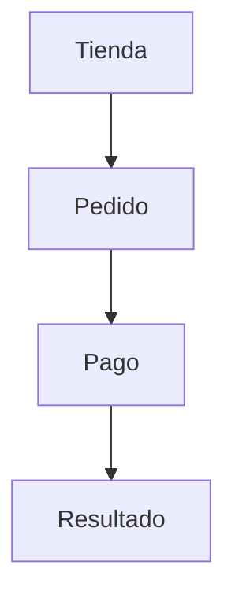

# Sitemap

Fuente: la agrupación de pantallas de este plugin. No es un diagrama de paquetes UML. Evaluar si la gente encuentra un ítem en esa jerarquía es tree testing (`medir-con-usuarios`), no este mapa.

## Qué fija

Qué pantallas existen y cómo se agrupan.

## Qué deja abierto

El camino de una tarea (user flow) y el aspecto de cada pantalla.

## Cómo hacerlo

1. Un grupo es un lugar del producto (Cuenta, Pedido, Pago). Una hoja es una pantalla.
2. Cada pantalla nombra la tarea o el caso de uso que cubre. Si una pantalla no cubre ninguna, pregunta antes de incluirla.
3. Mermaid `flowchart` de arriba hacia abajo, o una lista anidada si el mapa es corto. Sin notación UML.
4. No renombres grupos para «mejorar» el mapa. Los nombres son los del producto o los que el usuario acaba de decidir. Proponer otros nombres es una decisión (`registrar-decision`) o un hallazgo de card sorting.

## Plantilla

````markdown
# Sitemap — <producto>

- Plataforma:
- Fuente: mapa de pantallas de este plugin. No es UML.



## Pantallas

| Grupo | Pantalla | Tarea o caso de uso |
| --- | --- | --- |
````

## Ejemplo

Tienda → Pedido → Pago → Resultado. Pago cubre la tarea «pagar con tarjeta». Resultado cubre la misma tarea, en el estado de éxito.
