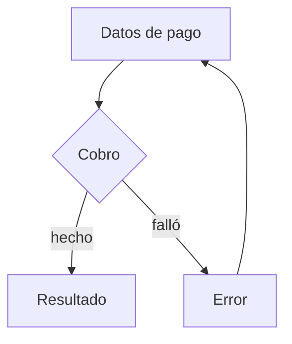

# User flow

Fuente: Nielsen Norman Group, Task Analysis, para la tarea que el camino completa. El dibujo es un flujo de pantallas en Mermaid, no un diagrama UML.

## Qué fija

El camino entre pantallas para completar una tarea, incluidas las decisiones y las vueltas.

## Qué deja abierto

El layout de cada pantalla. Eso es el wireframe o el wireflow.

## Cómo hacerlo

1. Un nodo es una pantalla. Una decisión es un rombo con salidas nombradas. El inicio es la primera pantalla de la tarea.
2. Todo camino termina en éxito, en un error del que se puede salir, o en una salida que el usuario haya pedido. Si un nodo no tiene salida, es un callejón: márcalo y deja la entrega `proposed` hasta resolverlo.
3. El error de una tarea que conserva datos vuelve a la pantalla donde están esos datos.
4. Usa `flowchart`. No uses sintaxis de actividad, estado ni secuencia UML.
5. El Markdown nombra la tarea y lista las pantallas.

## Plantilla

````markdown
# User flow — <tarea>

- Tarea o caso de uso:
- Fuente: Nielsen Norman Group, Task Analysis. Este flujo no es UML.



## Pantallas

| Pantalla | Tarea que cubre |
| --- | --- |
````

## Ejemplo

Pagar con tarjeta. De «Datos de pago» se pasa a «Resultado» si el cobro se hace, o a «Error» si falla. «Error» vuelve a «Datos de pago».
